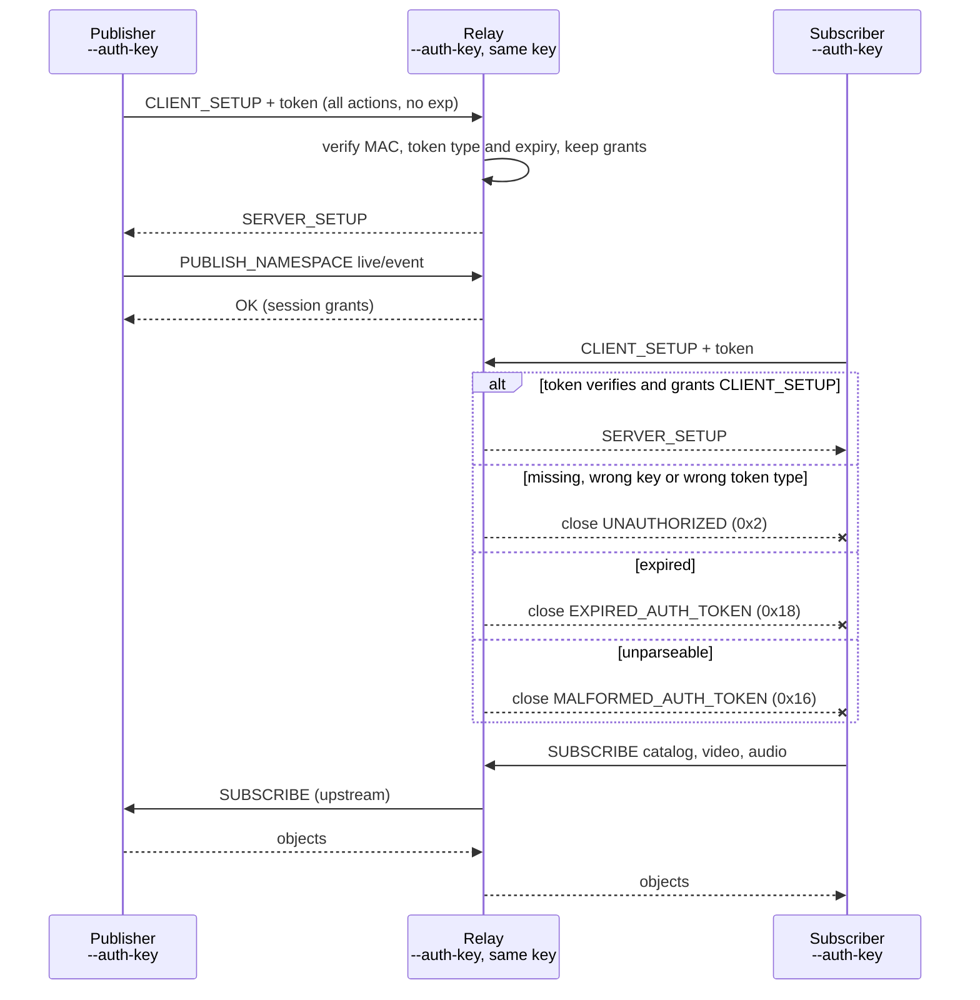
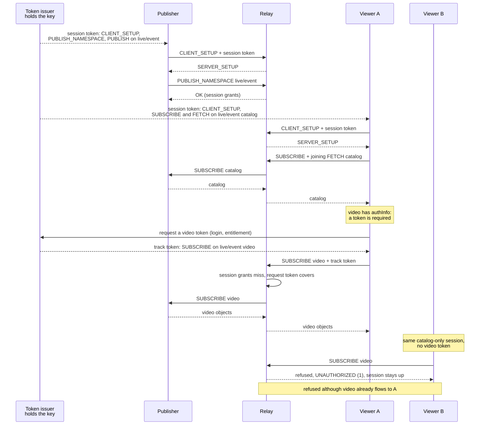
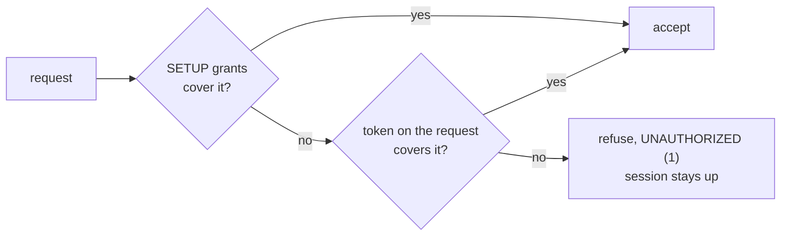

# CAT auth flows

How Common Access Tokens move through MoQT sessions on aiomoqt-relay and moqx. Both verify
the same token format, so they can share a key. The relay is the only enforcer: it checks the
SETUP token, then (from d16) each request against that token's grants or a token on the
request. Publishers and catalogs enforce nothing.

## Session-only

Each client started with `--auth-key KID:SECRET` mints its own token: every action, any
namespace and track, no expiry. Suited to test rigs and trusted clients: whoever holds the
secret can mint any token, and only a key change revokes one.



## Narrow sessions, track tokens named by the catalog

An issuer holds the key and scopes each token. The publisher's session covers its namespace;
a viewer's session covers only the catalog. A catalog track with `authInfo` tells the viewer
to get a token for it before subscribing; the relay never reads the catalog, it only checks
the token the viewer attaches.



A bearer token works for whoever presents it: a token placed in the catalog itself protects
the track only as far as reading the catalog is restricted.

## The relay's check on each request

Checked from d16: SUBSCRIBE, FETCH, SUBSCRIBE_NAMESPACE, SUBSCRIBE_TRACKS, TRACK_STATUS, PUBLISH
and PUBLISH_NAMESPACE. A token covers a request when it verifies, has not expired, and grants
the action on the request's namespace and track.



- A joining FETCH is checked against the track of the subscription it joins.
- REQUEST_UPDATE is not checked; at d14 only SETUP is.
- A running subscription is not re-checked when its token expires.
- moqx also accepts a request its `anonymous_claim` covers, and ignores request tokens under
  `allow_request_token_override: false`; aiomoqt-relay has neither setting.

aiomoqt's tools mint session tokens only; `MediaSubscriber` keeps `authInfo` but does not act
on it. From the library, pass a track token as a request parameter:

```python
from aiomoqt.cat import ACTION_SUBSCRIBE, CatAuth
from aiomoqt.types import ParamType

issuer = CatAuth("cat-dev", secret)  # runs at the issuer, not in the viewer
token = issuer.mint([ACTION_SUBSCRIBE], namespace="live/event", track="video")
await session.subscribe("live/event", "video",
                        parameters={ParamType.AUTH_TOKEN: token}, wait_response=True)
```
